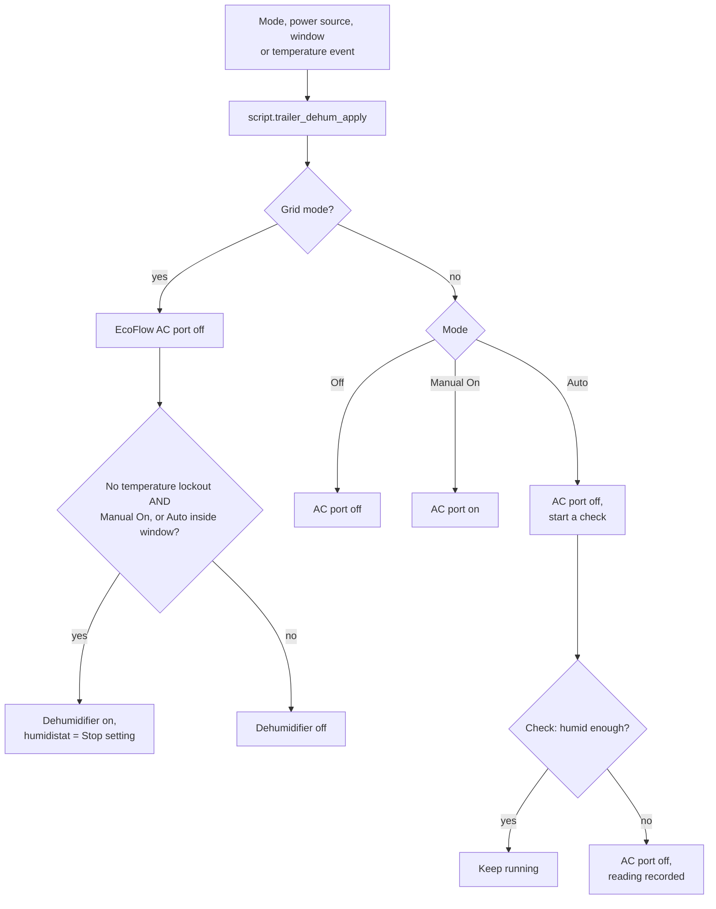

# How it works

The settings below are written as their name in the defaults block, followed by the default value in brackets, for example `settle_minutes (5 min)`. Every one of them lives in the first block of `packages/trailer_dehumidifier.yaml` (`sensor.trailer_dehum_defaults`).

## Three choices drive everything

| Control | Options | Effect |
|---|---|---|
| **Mode** (`input_select.trailer_dehum_mode`) | Off / Auto / Manual On | Off: never runs. Auto: the rules below decide. Manual On: on now, with no automatic stopping (alerts still go out) |
| **Grid Mode** switch (`input_boolean.trailer_dehum_grid_mode`) | off = EcoFlow, on = Grid | Where the dehumidifier is plugged in. You set this by hand to match the plug |
| **Low-rate window** (`binary_sensor.trailer_dehum_grid_window`) | automatic | Weekdays from `window_evening_hour (21)` to `window_morning_hour (7)`; all day Saturday and Sunday. **Grid mode only**: Auto runs the dehumidifier only inside it. EcoFlow mode runs at any time of day |

One script, `script.trailer_dehum_apply`, puts the AC port and the dehumidifier where they belong. It doesn't touch any other EcoFlow automation. It runs whenever any of these happen:

- the mode changes
- the power source changes
- the low-rate window opens or closes (Grid mode)
- the temperature lockout sets or clears

## EcoFlow mode (running on battery)

The dehumidifier's own sensors are the only humidity reading in the trailer, and they go offline whenever the AC port is off. So in Auto, the automation **samples** the air:

1. **Schedule.** The schedule is checked every 15 minutes. A check starts once `check_hours (3)` have passed since the last one, at any time of day.
2. **Power up.** The EcoFlow AC port turns on.
3. **Wait for it to come online.** There is no fixed delay. The script waits until the dehumidifier's humidity reading shows up in Home Assistant, which means the outlet is live, the unit has booted, and it has rejoined Wi-Fi, so Tuya Local can reach it. If nothing arrives within `online_timeout (00:10:00)`, the AC port turns off and the activity log records "did not come online".
4. **Settle.** The dehumidifier is switched on with its humidistat at the Stop setting. It then runs for `settle_minutes (5 min)`, a dashboard setting (**Settle time before reading**). Right after power-up the unit's sensor reads damp air trapped inside the unit: the reading starts 15–25 points high and falls fast for 2–3 minutes, then slowly. The settle time lets the fan flush that air and draw trailer air across the sensor before the reading is used.
5. **Decide.** It keeps running only if all of these are true:
   - humidity is above the Start setting, `start_humidity (45 %)`
   - the temperature lockout isn't set
   - the tank isn't full

   Otherwise the AC port turns off.
6. **End the run.** A run ends when any of these happens:
   - humidity drops below the Stop setting, `stop_humidity (40 %)`
   - the temperature lockout sets
   - the tank fills

**Time of day doesn't matter in EcoFlow mode.** It's off grid, and daytime runs get help from solar. The low-rate window applies to Grid mode only.

**Manual On in EcoFlow mode** only switches the AC port on. No "on" command is sent to the dehumidifier, which starts in whatever state it was last left (its own power-on memory).

**Start can never be below Stop.** If you move Start below Stop, Stop follows it down. If you move Stop above Start, Start follows it up. Without this, Auto would start and stop the dehumidifier on the same check.

### Low trailer battery

The trailer battery keeps charging the EcoFlow, so the trailer battery is the level that matters. When it stays below `trailer_low (20 %)` for `low_battery_for (00:05:00)` with Grid mode off:

- **Mode is set to Off**, which turns the AC port off. The previous Mode is kept in `input_text.trailer_dehum_mode_before_low_battery`.
- **Your phone gets the message** *Time to set the trailer "On Grid".*
- **Turning Grid mode on** puts Mode back to what it was, and the dehumidifier carries on from house current.

The same happens if Grid mode is turned off while the battery is already below `trailer_low`.

Nothing is locked: choosing a Mode by hand works at any time and clears the remembered Mode.

### Temperature lockout

The temperature lockout (`input_boolean.trailer_dehum_temp_out_of_range`) sets when the dehumidifier's own temperature reading is outside `min_temp_f (41 °F)` – `max_temp_f (95 °F)` for `out_of_range_for (00:02:00)`. It works the same in both power modes:

- **While set:** in Grid mode the dehumidifier is off. In EcoFlow mode a run in progress ends, and checks still read the air but don't start a run.
- **Dashboard:** the Lockouts card shows a red **Trailer Temp out of range, (xx°F).**
- **Clears:** once the temperature is at least `range_margin_f (3 °F)` inside the range (44–92 °F with the defaults). In Grid mode it must stay there for `back_in_range_for (00:10:00)`. In EcoFlow mode the unit is unpowered between checks, so the next check's reading clears it.

## Grid mode (plugged into house current)

- The EcoFlow is left out entirely: the AC port is off and battery levels are ignored.
- **Auto** runs the dehumidifier during the low-rate window on its own humidistat, set to the Stop setting. It turns on as soon as the window opens, in the warmer early evening.
- **Manual On** runs it now, until the low-rate window closes.
- **When the window closes**, everything turns off, Manual On included.
- **Temperature lockout:** see [Temperature lockout](#temperature-lockout). While it's set, the dehumidifier stays off; it turns back on by itself when the lockout clears.

## Lockouts card

The dashboard's **Lockouts** card lists every active lockout. When there are none, it shows a green **No Lockouts Active** with a check mark. In Grid mode outside the low-rate window with humidity at or below the Start setting, that's normal: it reads *Humidity within set parameters, system will check at 21:00.*

| Lockout | Shown as |
|---|---|
| Low trailer battery (Mode set to Off) | Red: battery %, cutoff, and the Mode it returns to |
| Mode Off (set by hand) | Blue: Mode is Off |
| Temperature lockout | Red: Trailer Temp out of range, (xx°F). |
| Tank full | Red: clear the drain hose and empty the tank |
| Dehumidifier stopped itself, too cold or too hot | Red, with the temperature |
| Did not come online at the last check (`binary_sensor.trailer_dehum_offline`) | Amber; clears at the next real reading |
| Grid mode outside the low-rate window, Mode Auto, humidity above the Start setting | Amber: runs wait for the window at `window_evening_hour` |

Switching between Grid and EcoFlow mode isn't treated as a lockout.

## Alerts

Alerts are sent to `notify.mobile_app_your_phone`:

- **Time to set the trailer "On Grid".** The trailer battery has been below `trailer_low (20 %)` for `low_battery_for (00:05:00)` with Grid mode off, and Mode has been set to Off. Sent once each time the battery drops below the level.
- **Tank full.** The unit drains through a hose into the bathtub drain, which empties into the gray-water tank. A full tank means the hose is blocked, kinked or dislodged. See [dehumidifier.md](dehumidifier.md#drain-hookup).
- **Too cold or too hot.** The dehumidifier shut itself down.

## Tracking

| Entity | What it holds |
|---|---|
| `sensor.trailer_last_known_humidity` | The last real humidity reading, with its temperature and the time it was taken, so it stays visible while the unit is unpowered |
| `sensor.trailer_dehumidifier_activity_log` | The newest `log_length (40)` events, newest first. Survives restarts |
| `sensor.dehumidifier_fan_speed` | Off / Low / High, for dashboard cards |
| `input_text.trailer_dehum_status` | The latest automation decision, in one line |

## Changing a setting

| Setting | Where to change it |
|---|---|
| Start, Stop, check interval, battery cutoff | Dashboard sliders. The **Reset Settings to Defaults** script (`script.trailer_dehum_reset_defaults`) puts them back to the defaults block values |
| Operating range, low-rate window hours, waits, margins, log length | Edit the defaults block, then go to **Developer tools → YAML** and reload Template entities, Scripts and Automations |
